<a href="https://github.com/shrijacked">
  <picture>
    <source media="(prefers-color-scheme: dark)" srcset="https://raw.githubusercontent.com/shrijacked/shrijacked/main/dark_mode.svg">
    <source media="(prefers-color-scheme: light)" srcset="https://raw.githubusercontent.com/shrijacked/shrijacked/main/light_mode.svg">
    
  </picture>
</a>
